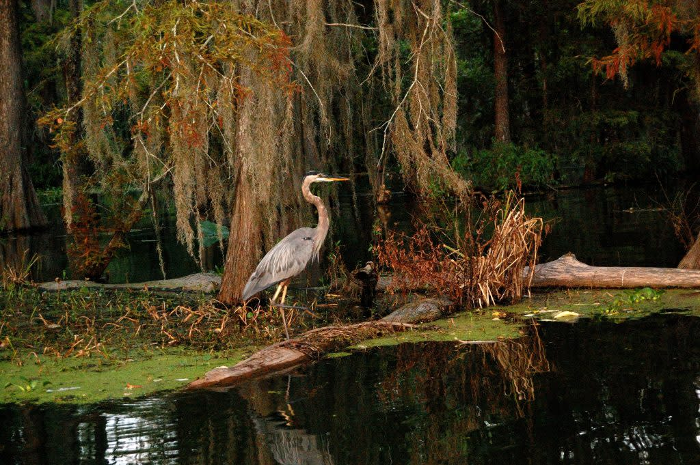

# Bird Observations

**Bird Biodiversity Analysis at Lake Louise and Valdosta State University**

This shiny application is a comprehensive tool designed for analyzing bird species abundance and biodiversity from Lake Louise and Valdosta State University campus. 
You will need to compile the results and figures into a short report. Remember to cite the packages used.




## Quick Start Guide

### Prerequisites

Before installing BirdLab App, ensure you have:

1. **R** (version 4.0 or higher) - [Download here](https://www.r-project.org/)
2. **RStudio** (recommended) - [Download here](https://www.rstudio.com/)

### Step 1: Download the App

**Option A: Download ZIP file**
1. Click the green "Code" button on this GitHub page
2. Select "Download ZIP"
3. Extract the ZIP file to your desired location

**Option B: Git clone (if you have Git installed)**
```bash
git clone https://github.com/Brandon-Thomas-Hendrickson/VSU_LOUISE_LAB
cd VSU_LOUISE_LAB
```

### Step 2: Install Required R Packages

Open R or RStudio and run the following commands to install all required packages:

```r
# Install required packages
required_packages <- c(
  "shiny",           # Web application framework
  "shinydashboard",  # Dashboard layout
  "DT",              # Interactive tables
  "ggplot2",         # Data visualization
  "plotly",          # Interactive plots
  "vegan",           # Ecological diversity analysis
  "rinat",           # iNaturalist API interface
  "dplyr",           # Data manipulation
  "tidyr",           # Data tidying
  "leaflet",         # Interactive maps
  "leaflet.extras"   # Additional mapping tools
)

# Check which packages need to be installed
new_packages <- required_packages[!(required_packages %in% installed.packages()[,"Package"])]

# Install missing packages
if(length(new_packages)) {
  install.packages(new_packages, dependencies = TRUE)
}

# Load all packages to verify installation
lapply(required_packages, library, character.only = TRUE)
```

### Step 3: Launch the Application

**Option A: Using RStudio**
1. Open RStudio
2. Navigate to the BirdLab_App folder and set working directory
4. Run the following command in the R console:

```r
setwd("VSU_LOUISE_LAB")
library(shiny)
runApp('inst/shiny-app')
```

**Option B: From R Console**
1. Set your working directory to the VSU_LOUISE_LAB folder:
```r
setwd("path/to/VSU_LOUISE_LAB") 
library(shiny)
runApp('inst/shiny-app')
```

**Option C: Direct path (if you want to run from anywhere)**
```r
library(shiny)
runApp("/full/path/to/VSU_LOUISE_LAB/inst/shiny-app") 
```

### Step 4: Access the Application

After running the app, you should see a message like:
```
Listening on http://127.0.0.1:XXXX
```

1. Open your web browser
2. Go to the displayed URL (usually `http://127.0.0.1:3838` or similar)
3. The app interface will load

### Step 5: Stop the Application

To stop the app:
- In RStudio: Click the red "Stop" button in the Console
- In R Console: Press `Ctrl+C` (Windows/Linux) or `Cmd+C` (Mac)

## Instructions for Lab

### 1. **Diversity Analysis Tab**
1. **Upload Data**: Click "Choose CSV File" and select your bird count data
   - Format: Rows = sites, Columns = species, Values = abundance counts
   - Must contain only numeric values (no negatives)
2. **View Results**: Explore diversity indices and interactive plots
3. **Download**: Export results using the download button

### 2. **iNaturalist Data Tab**
1. **Define Search Area**: 
   - Use the map drawing tools to select a rectangular search area
   - Draw by clicking and dragging on the map
2. **Fetch Data**: Click "Fetch iNaturalist Data" to retrieve observations
3. **Explore Species**: 
   - Click on species bars to view photos and information
   - Use the species number slider to adjust how many species to display
   - Click educational links to learn more about each species
4. **Interactive Map**: Switch to map view to see observation locations

### 3. **Sampling Curves Tab**
1. **Upload Sampling Data**: Choose CSV with columns: Time, Transect, [Species columns]
   - Data can include multiple transects (A, B, C, D, etc.)
   - Time values should be sequential (1, 2, 3, ...)
   - Species columns contain abundance counts for each time/transect combination
2. **View Educational Curve**: Explore the annotated sampling curve showing:
   - Species accumulation over time
   - Automatic saturation point detection
   - Educational annotations about sampling efficiency
3. **Analyze Sampling Probability**: View additional visualization showing:
   - Probability of finding new species at each time point
   - Diminishing returns visualization
   - Multi-transect analysis for comprehensive understanding
4. **Learn**: Understand sampling theory, saturation points, and research efficiency
5. **Export**: Download curve data, probability analysis, and insights

## Data Format Requirements

### Diversity Analysis Data
```csv
Site,Species_A,Species_B,Species_C,Species_D
Site_1,5,3,0,2
Site_2,2,7,1,4
Site_3,0,2,8,1
```

### Sampling Curve Data
```csv
Time,Transect,Robin,Cardinal,BlueJay,Sparrow
1,A,2,1,0,3
2,A,1,2,1,2
3,A,0,1,2,1
4,A,3,0,1,4
1,B,1,0,2,2
2,B,2,1,1,3
3,B,1,2,3,1
4,B,0,1,2,4
```

### Running on a Server
To deploy for multiple users:

```r
# Install on server
library(shiny)
runApp('inst/shiny-app', host = "0.0.0.0", port = 3838)
```

## License

This project is licensed under the MIT License - see the [LICENSE](LICENSE) file for details.

## Acknowledgments

- **iNaturalist** for providing citizen science data
- **GBIF** for global biodiversity information
- **OneZoom** for tree of life visualizations
- **Lake Martin, Louisiana** for inspiring this educational tool
- The **R community** for excellent package development

---
